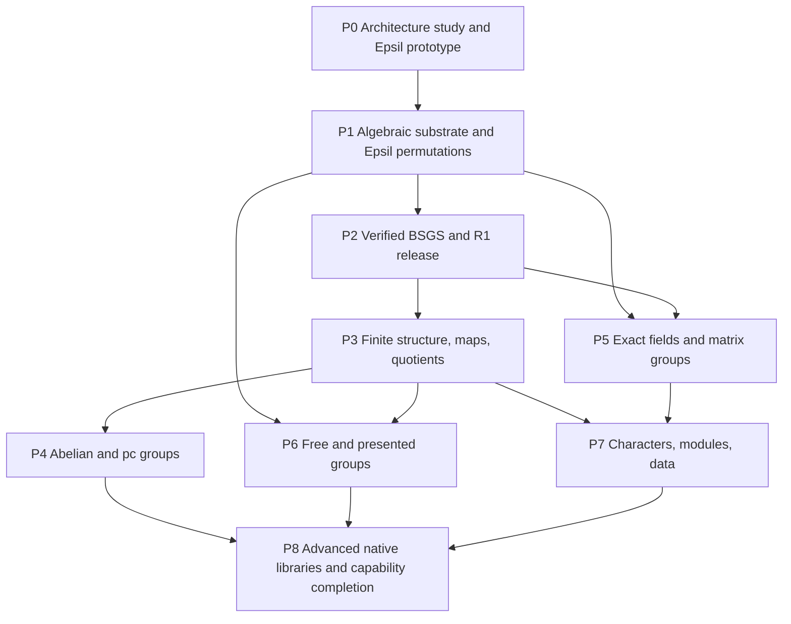

# Epsil-native group theory: infrastructure and delivery plan

Status: proposed, 2026-10-25. Scope and rationale: [PRD](../group-theory/PRD.md). Work-family IDs: [coverage map](../group-theory/COVERAGE.md).

Phase 0 has started: the worktree now includes a source-backed architecture study, proposed foundation decisions, and a bounded Epsil research prototype. An opt-in validated permutation and bounded group foundation now exists; base-capability release work remains pending. No milestones, staffing commitments, or release dates have been approved.

## 1. Delivery strategy

Build a small exact algebra kernel that fits Compute Engine, deliver finite permutation groups, then add representations and structural algorithms through explicit maps. Keep capability coverage visible from day one. Treat advanced packages as independently scoped projects sharing the same contracts and test infrastructure.

Build our own Epsil group-theory system on Compute Engine, informed by studying how GAP organizes its algebraic objects, representations, methods, and algorithms. Extend CE's existing framework with the missing algebraic infrastructure. GAP may run separately as a development test oracle; GAP parsing, API emulation, and production runtime bridging are outside this project.

The user requested isolation from existing Compute Engine work. Keep this initiative in its attached worktree on `codex/gap-group-theory-plan`. Do not apply these files onto the integration branch as part of this task. Continue the research and base-capability work here, bringing upstream changes in deliberately. The user has now authorized an initial draft PR for maintainer feedback on the implemented foundation; keep extending that branch and incorporate review before treating it as release-ready.

## 2. Dependencies and milestones

P5 field work and P6 word infrastructure can start after P1 if contributors are available. Matrix structure still needs P2/P3; pc-based quotient work in P6 needs P4. Catalog ingestion can be researched early, but native Epsil catalog APIs wait for stable domains, maps, and data review. The arrows describe prerequisite capabilities, not permission to edit shared modules concurrently.

## 3. Phase plans and exit gates

### P0 — Study GAP, design our substrate, and prove an Epsil workflow

Estimated effort: 3-5 person-weeks. Owner roles: product lead, algebra lead, CE runtime maintainer.

Current progress (updated 2026-10-26):

- [Architecture study](../group-theory/PHASE0-ARCHITECTURE.md) maps GAP families, filters, attributes, dispatch, generators, stabilizer chains, and maps to actual CE/Epsil source.
- [Foundation decisions](../group-theory/FOUNDATIONS.md) propose concrete invariants and the first implementation sequence.
- [Source manifest](../group-theory/phase0-sources.json) pins and hashes thirteen core files at GAP 4.16.1; the full distribution/manual/package snapshot remains open.
- [Research probe](../../scripts/group-theory/phase0-probe.ts) passes ten checks, including bounded Epsil S3 closure, generic operations over two element types, noncommutativity, reload, checkpoint restore, and exact integer transport. It also reproduces constructor-validation and collection-typing limitations.
- The [validated permutation spike](../group-theory/VALIDATED-PERMUTATIONS.md) adds immutable values, checked CE constructors, ordered composition/inverse, finite-action compatibility, portable descriptors, and lifecycle checks. Its two suites pass 57 tests, and a complete opt-in Epsil example runs. No core runtime changes were needed.
- [Generator-based descriptors and bounded closure](../group-theory/GROUPS-AND-CLOSURE.md) now preserve explicit actions, validate all generators, and return only fully completed finite enumerations. The four combined suites pass 108 tests. A typed Epsil S3 workflow and an empty-generator trivial group are executable.
- [Point orbits and Schreier transversals](../group-theory/ORBITS-AND-TRANSVERSALS.md) add complete point-action searches, compact generator paths, inverse representatives, and bounded right transversals. The six combined suites pass 159 tests. The [chapter 43 dependency plan](../group-theory/GAP-43-ROADMAP.md) covers the requested permutation-group surface; the next increment is now the [verified group baseline](../group-theory/VERIFIED-GROUP-BASELINE.md), with exact order/membership, point stabilizers, subgroup inclusion/index/equality/normality, and element operations. Eight suites pass 202 tests, including exact S20 order and certificate rejection.
- Public API/loading decisions, optimized chain construction and original-generator word certificates, independent GAP execution, broad capability/package inventory, benchmarks, and expert design review remain open. P0 is not complete.

Deliverables:

- Freeze GAP 4.16.1 and a proposed package snapshot with checksums. Reconcile moving online manuals against release documentation.
- Produce a mathematical capability inventory and classified package landscape. Consolidate reference functions into user tasks and representation-specific guarantees. Record unexamined areas; source API counts are not the success metric.
- Study GAP's families/categories, filters and property knowledge, attributes/caches, method selection, generators, and conversion maps. Record the problem each mechanism solves, the corresponding CE facility, and our proposed extension. Write architecture decisions for domains/elements, group arithmetic, equality, serialization, uncertainty, dispatch, and Epsil library organization.
- Prototype an Epsil program that constructs a group, computes with elements, composes a reusable function, and survives serialization/reload and checkpoint restore. Exercise noncommutativity. Implement a small high-level operation in Epsil over proposed engine primitives to establish the Epsil/TypeScript boundary; record missing language facilities rather than assuming they exist.
- Audit exact-field and integer primitives for reuse, with a list of missing field/matrix capabilities and current limits.
- Establish a pinned GAP runner, bounded request protocol, fixture format, independent small-case oracle, and benchmark environment.
- Assign owners and review license/provenance requirements before importing external artifacts.

Exit gate: one complete Epsil S3 workflow, a reviewed GAP-to-CE architecture study, a demonstrated Epsil/TypeScript implementation boundary, a convention fixture distinguishing multiplication order, portable exact integers, a native mathematical capability inventory, explicit research gaps, and reviewed contracts. If boxed values force costly architectural changes, revise the estimate before P1.

### P1 — Algebraic infrastructure and the Epsil permutation library

Estimated effort: 4-7 person-weeks. Families F01-F04, F39. Developer preview only.

Build immutable permutation elements, validated constructors, arithmetic, cycle/support operations, and exact element order. Add generator-based group descriptors and named trivial/cyclic/symmetric/alternating/dihedral constructors. Implement a strictly bounded closure enumerator for teaching/reference tests; do not present it as the production membership strategy.

Implement the shared domain/element/operation contracts and connect them to CE types, evaluation, library definitions, and MathJSON. Design an idiomatic Epsil vocabulary and complete executable examples for construction, arithmetic, queries, and reusable functions. Use existing syntax where sufficient; justify any notation or language extension through a concrete workflow. Implement capability queries, budget plumbing, cache ownership, and checkpoint tests. Keep loading optional and derive host APIs from the same native model.

Exit gate: GT-001, GT-002, and initial GT-006 through GT-008 pass; exhaustive arithmetic through S6, invalid-input tests, and cross-engine serialization pass. Documentation calls out the preview's closure limits. No expensive work occurs during boxing or pretty-printing.

### P2 — Scalable finite permutation groups and R1

Estimated effort: 6-10 person-weeks. Families F05-F08, F38.

Implement deterministic Schreier-Sims first: orbit trees/transversals, stabilizer generators, sifting, chain completion, verification, exact order, and constructive membership. Retain generator words or straight-line programs where needed to explain membership. Use verified chains for point stabilizers, subgroup inclusion/index, transitivity, and bounded iteration.

A randomized builder is an optimization after deterministic correctness. It must verify completion before publishing an exact order or negative membership answer. A partially built chain must never become a cached proof.

Add browser-worker execution for expensive calls, cancellation behavior, explicit logical allocation limits, opt-in loading, and reproducible performance reports. Include sparse-support, intransitive, imprimitive, redundant-generator, and adversarial inputs as well as S20.

Exit gate: every R1 requirement GT-001 through GT-008 passes the PRD release criteria. No closure enumeration in scalable order/membership paths. Verify independent BSGS certificates, reload behavior, negative membership, and abort during chain construction. Release a useful permutation-group package with an honest support table.

### P3 — Finite group structure, maps, and quotients

Estimated effort: 10-18 person-weeks. Families F06-F19, incremental.

Sequence work as: richer actions/cosets; subgroup operations; normality and quotient projections; homomorphisms/kernels/images; conjugacy/centralizers/normalizers; structural subgroups and series; products; bounded subgroup enumeration. Select algorithms per representation and size regime. Full subgroup lattices and general automorphism searches must not block basic quotients.

Exit examples: S4/A4 has order 2 and the expected projection kernel; S3 has three conjugacy classes of sizes 1, 2, and 3; the derived subgroup of S3 has order 3; orbit-stabilizer and map composition identities hold on randomized cases. Exact generated maps must be independently verified. Each subrelease lists the finite families actually covered.

### P4 — Abelian, solvable, and pc representations

Estimated effort: 10-18 person-weeks for an initial finite scope. Families F20-F22, portions of F11-F18/F29.

Build finite/finitely generated abelian coordinates and integer normal-form support first. Introduce validated power/conjugation presentations, collection, normal forms, induced pc sequences, subgroup/quotient maps, and finite solvable conversions. Reuse generic group contracts without forcing pc elements into permutation arrays.

Gate infinite polycyclic algorithms as a separate scope extension. An inconsistent input presentation must not acquire a false finite order from the product of supplied relative orders.

Exit examples: C4 x C2 distinguishes element order from group order; quaternion group Q8 has order 8 and center order 2; multiple collection strategies agree; finite pc/permutation round trips preserve operations. Consistency failures and unverified presentations produce explicit outcomes.

### P5 — Exact finite fields and matrix groups

Estimated effort: 12-22 person-weeks for an initial finite-field scope. Families F23-F24.

Audit and reuse polynomial field primitives; add GF(p^n), field identity/embeddings, exact matrix algorithms, immutable matrix elements, and invertibility checks. Specify row/column action conventions and prove consistency with permutation actions. Begin with prime fields and small extension fields, then named GL/SL families and bounded faithful-action methods.

A faithful conversion is a baseline, not a promise that enumerating vector spaces scales. Large-dimension recognition and characteristic-zero/arithmetic groups remain explicit later cells.

Exit examples: GL(2,3) has order 48; SL(2,3) has order 24; GF(4) arithmetic and inverse laws pass; singular generators and incompatible fields are rejected; any reported faithful action has a checked kernel/certificate. State exactly which inputs support order and membership.

### P6 — Free and finitely presented groups

Estimated effort: 12-24 person-weeks for the first bounded algorithms. Families F26-F29.

Implement reduced free words and substitutions, then presentations, bounded Todd-Coxeter coset enumeration, low-index searches, subgroup rewriting, and transformations with explicit maps. Add completion and quotient methods in separate increments. Pc-dependent nilpotent/solvable quotients require P4.

Treat equality for arbitrary presented groups as a potentially unresolved computation. Incomplete rewriting and incomplete coset tables cannot justify negative claims or a group order. A finite coset action proves an image; it proves group order only under appropriate additional evidence, such as a complete enumeration relative to the trivial subgroup.

Exit examples: free reduction cancels inverse pairs; the presentation `<a,b | a^2,b^3,(ab)^2>` yields order 6 by a certified supported method; the rank-one free group is recognized as infinite; forced budget exhaustion stays distinct from infinity and inequality. Test maps on relators and independently replay completed coset tables.

### P7 — Characters, representations, and data

Estimated effort: 16-30 person-weeks for a narrow initial scope, not all representation theory. Families F30-F33, F35.

Build exact cyclotomic coefficients and class correspondence, then ordinary character calculations and table operations. Add induction/restriction and decomposition only after validating class fusion maps. Separate ordinary from modular character and representation support; defer advanced modular algorithms to explicitly owned cells.

In parallel where staffing permits, introduce optional catalog providers with signed or checksummed manifests, pinned versions, attribution, partitions, explicit offline installation, and stable namespaces. Start with a small reviewed data slice and expand. Table lookup and algorithmic table computation are separate coverage cells.

Exit examples: S3 character degrees are 1, 1, and 2; orthogonality and the sum-of-squared-degrees identity hold exactly; table row/column permutations do not cause false differential failures; catalog IDs round-trip within the pinned dataset and fail clearly outside installed ranges.

### P8 — Advanced native libraries and capability completion

Effort: re-estimate by package and capability after prerequisites; no responsible aggregate completion date yet.

Create independent work packages for constructive recognition, general automorphism/isomorphism algorithms, larger subgroup searches, p-group generation, cohomology and extensions, specialized infinite groups, crystallographic/automaton groups, and remaining data/package functionality. Audit package dependencies that use native programs or other computer algebra systems.

Each native library plan requires a mathematical capability ledger, algorithm literature, data/provenance review, platform plan, benchmarks, and an expert reviewer. Add WASM/native kernels only when measurement justifies their maintenance and packaging cost. Verify equivalent mathematics across our implementation backends and keep the public Epsil model coherent.

Exit gate for the full mathematical-breadth objective: no unexamined group-related areas in the reference landscape, required capabilities and data access implemented in Epsil/CE, explicit handling of partial procedures, and an independent audit of mathematical coverage and Epsil workflows. A successful R1 or R2 is not this gate.

## 4. Initial work backlog

These items are intended to become small reviewable changes; identifiers are local planning IDs, not created external issues.

| Item | Deliverable | Depends on | Completion evidence |
| --- | --- | --- | --- |
| GT-PLAN-01 | GAP architecture study and mathematical capability landscape | CE/Epsil audit | Versioned references, mechanism-to-CE design table, algorithm research notes, explicit unexamined areas |
| GT-PLAN-02 | CE algebraic substrate ADR: domains, elements, maps, properties and equality | 01 | Permutations independent of subgroup; incompatible-domain and isomorphism examples resolved |
| GT-PLAN-03 | Noncommutative operator/convention ADR | 02 | p*q and q*p fixture; naming collision audit; dihedral convention |
| GT-PLAN-04 | Result, cancellation, budget and cache ADR | 02 | Failure-channel mapping to settled CE contracts; partial cache rejection |
| GT-PLAN-05 | End-to-end Epsil prototype and implementation-language boundary | 02-04 | Epsil S3 program and reusable operation; typing, exact counts, MathJSON, checkpoint and reload |
| GT-PLAN-06 | GAP runner and fixture normalizers | 01 | Pinned version recorded; timeout kills job; structured output validated |
| GT-PLAN-07 | Primitive permutation kernel | 03-05 | Bijectivity, inverse/product laws, exhaustive S6 arithmetic, randomized GAP comparison |
| GT-PLAN-08 | Group descriptors and bounded reference closure | 07 | Known small groups; degree/element limits; no implicit materialization |
| GT-PLAN-09 | Native Epsil group library and optional loading | 05, 07-08 | Idiomatic APIs, complete Epsil workflows, generated docs, shared host/MathJSON model, bundle report |
| GT-PLAN-10 | Orbits, transversals and Schreier generators | 07-08 | Independent orbit and stabilizer identities |
| GT-PLAN-11 | Deterministic BSGS, sifting and certificate verifier | 10 | Verified order/membership; generator-word replay; incomplete chains rejected |
| GT-PLAN-12 | Subgroups, inclusion/index and iteration | 11 | Mutual-inclusion equality; subgroup-index checks; bounded lazy iteration |
| GT-PLAN-13 | Worker execution and resource behavior | 04, 09, 11 | Abort, deadline inheritance, allocation caps, repeated-run leak checks |
| GT-PLAN-14 | R1 qualification and support guide | 06-13 | Corpus and performance gates, documented limits, reviewed release report |

Recommended first change: GT-PLAN-01, studying GAP's architecture alongside CE/Epsil extension points, followed by the substrate ADRs in 02-04. Keep the object-model prototype separate from the production algorithm changes so it is easy to revise.

## 5. Verification strategy

### Three independent sources of confidence

1. Differential results from pinned GAP, recording core/package versions, inputs, seeds, options, and execution limits.
2. A deliberately simple bounded closure implementation for small finite cases, separate from BSGS and advanced optimizations.
3. Mathematical laws and independently checked certificates: action laws, orbit-stabilizer, Lagrange where applicable, normality, map relations, chain validity, character orthogonality, and exact field identities.

Agreement with GAP is evidence, not an absolute proof. If implementations disagree, retain the minimized case and investigate both results; do not normalize away a mathematical discrepancy.

### Comparison rules

Compare group orders and Boolean facts directly. Compare subgroups by mutual inclusion in a common ambient domain, not generator-array equality. Verify returned maps by images and relations. Normalize unordered collections where order is not contractual. Compare character tables with class alignment and allowed row/column permutations. Compare isomorphism witnesses by checking them, not by expecting identical generator choices. Random outputs need law/certificate checks and documented distribution tests rather than byte-for-byte agreement across different RNGs.

### Execution safety and reproducibility

Keep the oracle runner outside production dependencies. Use structured requests and validated serializers; avoid concatenating untrusted strings into GAP programs or shell commands. Bound subprocess time, memory where supported, and output size. Kill the entire job on timeout. Persist machine-readable results and provenance without arbitrary code execution on load.

Version fixtures and their generator. Differential jobs can be optional for contributors without GAP installed, but release qualification requires the pinned oracle job. Unit/integration suites must remain useful offline. Do not import upstream tests verbatim without provenance review.

### Regression and benchmark coverage

Test noncommutative canonicalization, invalid image lists, empty generators, trailing fixed points, unsupported equality, exact integers above 2^53, wrong domains, unknown properties, resource exhaustion, cache invalidation, serialization, and checkpoint replay. Mutation of original input buffers must not alter values.

Track cold and warm timings, allocations, retained memory, worker overhead, and optional bundle size. Use a diverse pinned corpus. Benchmark optimizations against the same inputs and correctness evidence; report regressions rather than changing the benchmark set silently.

## 6. Effort, staffing, and planning limits

The phase estimates are judgment-based planning ranges, not measured velocity or commitments. They assume experienced TypeScript contributors with computational algebra expertise, access to a mathematical reviewer, stable CE interfaces, and no major licensing or data blockers. They include implementation, tests, integration, and documentation within each stated initial scope.

- P0-P2 total: **13-22 person-weeks**. With two substantially dedicated engineers and part-time algebra review, allow roughly **3-5 calendar months** for a reliable R1, including sequencing and review. A solo contributor should budget more elapsed time; part-time work stretches it further.
- P0-P7 listed initial scopes total **73-134 person-weeks**, before P8, ongoing maintenance, and expansion to the remaining mathematical capabilities and representations. This is not an estimate for complete GAP-scale mathematical breadth.
- P8 and full mathematical breadth are a multi-year program hypothesis, not a dated promise. Inventory results and specialist staffing determine whether that objective is practical.

Suggested roles: one kernel/algebra lead, one CE runtime/API engineer, part-time domain expert review, and shared testing/release support. Add specialists for matrix recognition, pc/presented algorithms, representation theory, and cohomology when those workstreams start. One person may fill several roles; the effort does not disappear.

At each phase exit, compare actual effort, correctness incidents, coverage growth, and performance against the plan; re-estimate the next two phases. Prioritize correctness and completed user workflows over maximizing function count.

## 7. Risks and mitigations

| Risk | Early signal | Mitigation / decision gate |
| --- | --- | --- |
| Compatibility work displaces native design | Function aliases and upstream signatures determine our API | Track mathematical tasks; review Epsil workflows and CE infrastructure; keep GAP as a research reference |
| Weak algebraic object model | Group values lose domain identity or trigger numeric sorting | P0 prototype and explicit operators before broad implementation |
| Exponential enumeration | Simple calls allocate all elements/cosets/subgroups | BSGS for core permutation queries; explicit caps and streaming; complexity documentation |
| Incorrect randomized results | Seed-dependent order or false negative membership | Deterministic baseline; verify randomized chains; expose uncertainty when required |
| Undecidable or partial procedures | A failed search becomes false/infinite | Distinct unknown/resource outcomes; certified subclasses; no universal termination promise |
| Finite-field reuse overestimated | Existing polynomial helper lacks embedding/equality guarantees | Audit early; isolate shared exact arithmetic; maintain coefficient-domain tests |
| GPL/data provenance conflict | Proposed source translation or catalog import lacks review | Original algorithm implementations; artifact-specific licensing gate |
| Browser memory/cancellation problems | Main thread freezes or partial caches survive abort | Worker boundary, bounded logical allocations, atomic cache publication |
| API pollution and bundle growth | Every user downloads catalogs or imports group kernels | Opt-in package entry, separate data packs, bundle inspection |
| Fragile differential tests | Equivalent groups produce different generator arrays | Semantic normalizers and independent witness verification |
| Specialist bottleneck | Complex algorithms lack a qualified reviewer | Assign domain reviewer before starting advanced phase; narrow scope visibly |
| Worktree/upstream drift | Runtime contracts change while algorithms are developed | Short topic changes, baseline refresh at phase boundaries, regression gates |

## 8. Definition of done for each implementation change

A change must reference native capability records and affected Epsil workflows, state preconditions and limits, include mathematical rationale and algorithm provenance, and demonstrate appropriate independent correctness evidence. Update public API docs and the support report. Run required repository checks plus relevant tests; do not claim unsupported representations based on generic signatures.

No imported code/data may bypass its provenance gate. No public result may conceal an incomplete algorithm or caller cancellation. Reviewers must be able to reproduce fixtures and explain why the returned answer is justified.

## 9. Planning-document validation

For this documentation-only delivery, validate relative links, source/baseline descriptions, phase dependencies, arithmetic in estimates, and working-tree isolation. Run the repository-required typecheck and record any environment limitation. Do not claim that drafting acceptance tests executes them or that a documentation check validates an algorithm.
