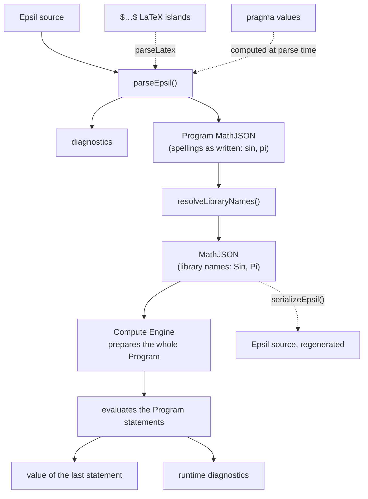

# Inside Epsil

This page is about **how Epsil is implemented**. Nothing here is needed to
write Epsil — the rest of the documentation describes the language on its own
terms. Read this page if you are embedding Epsil in a host application,
building tooling over it, or curious about what a construct actually does
underneath.

Epsil is a surface syntax over [MathJSON](/math-json/), and its runtime is the
[Compute Engine](/compute-engine/). A program is parsed into a MathJSON
expression, and that expression is evaluated by the engine. There is no
separate Epsil interpreter, no Epsil-specific declaration logic, and no
Epsil-side type checker — each language form maps onto a primitive the engine
already has.



`executeEpsil()` runs the whole chain. `parseEpsil()`, `resolveLibraryNames()`
and `serializeEpsil()` expose the individual stages to a host that boxes or
evaluates the tree itself.

## The JavaScript API

The public language entry point exposes the three stages directly:

```js
import {
  ComputeEngine,
  executeEpsil,
  parseEpsil,
  serializeEpsil,
} from "@cortex-js/compute-engine/epsil";
```

### Parsing

`parseEpsil(source, url?, options?)` returns a MathJSON `Program` and an
array of diagnostics, including for empty or single-statement source:

```js
const [expression, diagnostics] = parseEpsil("2x + 1");
```

Ignoring source-location metadata, the expression is:

```json
["Program", ["Add", ["Multiply", 2, "x"], 1]]
```

Empty source gives `["Program"]`. The parser recovers from most syntax errors
and returns a partial expression alongside its diagnostics. Every parsed node also carries source offsets so a
host can associate a diagnostic or expression with the original text.

The tree is exactly what was written: the lowercase spelling of a library
name (`sin`, `pi`) is still `sin` and `pi` at this point. A host that boxes
or evaluates the tree itself must first run `resolveLibraryNames(expression,
source, ce)`, which rewrites every free occurrence of a spelling to the
library name it stands for (`Sin`, `Pi`) while leaving names the program or
the engine binds alone — `executeEpsil` does this itself. See
[Naming](/epsil/naming/).

### Variables of a call

`binderSitesOf(ce, node, source)` tells which names of a call to a library
operator are the call's own variables, and which ones the call reads from
outside. It gives one site per bound variable: the name, and the operands
that see it (`"all"`, or the zero-based indices of the arguments; the head is
not counted):

```js
import {
  ComputeEngine,
  binderSitesOf,
  parseEpsil,
} from "@cortex-js/compute-engine/epsil";
import { operand } from "@cortex-js/compute-engine/math-json";

const ce = new ComputeEngine();
const source = "sum(k^2, k, 1, n)";
const [program] = parseEpsil(source);
const call = operand(program, 1);
binderSitesOf(ce, call, source);
// ➔ [{ name: "k", operands: [0, 1, 2, 3] }]
```

Here `k` is bound and `n` is read. The result is `[]` for a library operator
that binds nothing in the call (`max(pi, pi)`), and `undefined` for a call of
a name that is not a library operator. The function does not see the
bindings of the program: call it only for a call whose callee the program
does not define. A `limit`, `nLimit`, `nd` or `nIntegrate` that does not
write its variable binds the variable that the engine chooses, in its first
operand only: `limit(sin(h)/h, 0)` gives `[{ name: "h", operands: [0] }]`.
The engine can read values already installed by an earlier program or the
host, so its choice can depend on that state. When `L` already holds
`[1, 2]`, the variable of `limit(total(L)*t, 0)` is `t`, because `L` is a
list. The engine does not choose a `const` name. A host that knows the names the program binds at the
call gives them as a fifth argument,
`binderSitesOf(ce, call, source, undefined, (name) => …)`: when such a name
comes first and other names follow, the result is `[]`. Without it, the
result for this call is `[{ name: "L", operands: [0] }]`. A host that also
knows how the program declares such a name gives a sixth argument, a
function that returns a `ProgramDeclaration` for the name, or `undefined`:
`{ constant, annotated, value, boxedEarly }`, for a `let` or `const` at the
top level of the program that no other statement writes. `constant` is
`true` for a `const`, `annotated` is `true` when the statement has a type
annotation, `value` is the raw initializer, and `boxedEarly` is `true` when
the call is boxed before value declarations have executed. Every occurrence
in a `Program` has this timing, including direct top-level statements and
function bodies: the whole program is prepared before its first statement
runs. Constness is already known, so the helper excludes a `const` name
without evaluating its initializer. A mutable variable's execution value is
unavailable during that preparation, even when its declaration appears
earlier in the text; an annotation does not supply that value. The helper
leaves a value-dependent choice undecided rather than predicting execution.
For a host that really boxes a call after the relevant declarations have
executed, `boxedEarly: false` allows the later-value evidence instead.

### Sites of the names of a program

`epsilProgramSites(ce, source)` gives each name that a program spells, with
its range in the source, its role and the binding it resolves to. A host
that runs a program in a scope of its own (a notebook cell over the scope
of its section) reads from it which names come from outside the program,
without a copy of the scoping rules. The program is parsed and not run. A
name that the program does not bind is looked up in the current scope of
`ce`: call the function in the scope in which the program runs.

```ts
import { ComputeEngine, epsilProgramSites } from "@cortex-js/compute-engine/epsil";

const ce = new ComputeEngine();
ce.declare("k", "integer");
ce.assign("k", 5);
ce.declare("total", "integer");
ce.assign("total", 0);
ce.pushScope();
const source = "let k = k + 1\ntotal += k\nfor k in 1..3 { total += k }";
const { bindings, sites, externalWrites } = epsilProgramSites(ce, source);
for (const s of sites)
  console.log(source.slice(s.start, s.end), s.start, s.role, bindings[s.binding].kind);
// ➔ k 4 definition program
// ➔ k 8 read external
// ➔ total 14 read-write external
// ➔ k 23 read program
// ➔ k 29 definition local
// ➔ total 41 read-write external
// ➔ k 50 read local
externalWrites;
// ➔ ["total"]
ce.popScope();
```

The result has four fields:

- `bindings`: what the sites resolve to. The `kind` of a binding is
  `program` (a declaration at the top level of the program), `local` (a
  parameter, a loop or comprehension variable, a `match` binder, a `let` of
  a block, a variable that a library call binds), `external` (a binding of
  the engine that the program does not make), `library` (a definition of
  the standard library; `name` is the library name, `Sum` for a site that
  spells `sum`) or `unresolved`. A `program` or `local` binding has a
  `form` (`variable`, `function`, `parameter`, `loop`, `pattern`, `type`).
  An `external` binding has a `scopeDepth`: 0 for the scope the function
  is called in, 1 for the scope around it. The indexes are those of one
  result only.
- `sites`: the names, in source order. A site has `start` and `end` (UTF-16
  code units, the end excluded, the backticks of a verbatim name included),
  the index `binding`, the index `statement` of its top-level statement, a
  `role` and `deferred`. The role is `definition` (a variable that a
  library call binds has none: each of its sites is a read), `read` (the
  head of a call is a read), `write`, `read-write` (the target of `+=`, the
  collection of `a[1] = 2` or the record of `r.x = 2`) or `reference` (a
  name that reads no value: the label of a named argument, a type name in
  an annotation). `deferred` is `true` in the body of a function literal
  and in the default value of a parameter. Such a site runs when the
  function is called, which can be in the statement itself (a function
  given to `map`).
- `statements`: for each top-level statement, its range and the indexes of
  the `program` bindings that it `reads`, `defines` and `writes`, each one
  once. The sites of a function body count.
- `externalWrites`: the names of the `external` bindings that the program
  writes, in a function body included.

The resolution follows the rules of the interpreter. A `let` or a `const`
binds its name in its whole block, or in the whole program at the top
level: in `function g() { k }` followed by `let k = 7`, the `k` of the body
is the `k` of the program. The initializer of the statement is the
exception: `let k = k + 1` reads the outer `k`. An initializer that is a
function literal names the binding itself, so that
`let f = (n) => if n == 0 { 1 } else { n * f(n - 1) }` is recursive. An
assignment declares nothing: its target is a write of the binding that is
visible, which is an `external` binding when the program has none. The
collection of a `for` clause is read in the scope of its loop: in
`for n in 1..n`, the second `n` is the loop variable.

A host uses the result in three ways. The `external` sites with the role
`read` or `read-write` are what the program depends on. To run the program
with no write to the scope around it, the host declares a local copy of
each name of `externalWrites` first. To rename an `external` binding, the
host replaces the text of each site of that binding, and of no other site:
a site of a `program` or `local` binding of the same name keeps its text.

The sites are those of the source, not the inputs of the compiled or
simplified program: `v / v` has two sites. When the source has a parse
error, the sites are those of the tree that the parser recovered.

### Execution

`executeEpsil(ce, source, options?)` parses, resolves and boxes one `Program`,
then evaluates it in the current scope of `ce`. Boxing prepares every
statement before the first runs. The canonical order is types and protocols,
then function definitions with their paired signatures, then the other
statements in source order:

```js
const ce = new ComputeEngine();

const first = executeEpsil(ce, "let x = 5");
const second = executeEpsil(ce, "x = x + 1\nx");
// second.value.re === 6
```

Reusing the engine preserves declarations between calls, which is the
notebook/REPL execution model. A fresh `ComputeEngine` starts a fresh session.
The returned object contains the last statement's boxed value and all
diagnostics. Runtime failures are represented as error values rather than
escaping to the host as ordinary exceptions.

`$…$` LaTeX islands are read with the LaTeX syntax of the engine, as
`ce.parse(latex, { form: "raw" })` reads them. A host with a LaTeX parser of
its own gives it with the `parseLatex` option:

```js
const result = executeEpsil(ce, "2 * $\\frac{1}{2}$");
const parseLatex = (latex) => ce.parse(latex, { form: "raw" }).json;
const same = executeEpsil(ce, "2 * $\\frac{1}{2}$", { parseLatex });
```

Host-state pragmas remain disabled unless
`allowHostPragmas: true` is explicitly supplied. Pragma values are computed by
the parser and inserted into the produced MathJSON before execution begins.

A host can give an evaluation an explicit time budget by wrapping it in the
engine's `withTimeLimit()` span:

```ts
const result = ce.withTimeLimit(
  { ms: 500, label: "epsil-cell" },
  () => executeEpsil(ce, source, { parseLatex })
);
```

When the budget expires the program stops: `result.value` is the
`Error("Timeout exceeded", "timeout")` of the statement that hit the deadline,
`result.valueRange` points at that statement, and no later statement runs.
See [Evaluation](/epsil/evaluation/#interruptibility) for the rest of the
cancellation model.

### Asynchronous execution

`executeEpsilAsync(ce, source, options?)` runs a program as `executeEpsil`
does and returns a promise of the same result. Each top-level statement is
evaluated with `evaluateAsync()`, so an operator that has an asynchronous
route takes it: a `findFit` whose global search runs on the engine's worker
pool (`ce.workers`), or an operator that a host declared with only an
`evaluateAsync` handler. This includes the value of a `let` or of an
assignment: `let fit = findFit(…)` runs the asynchronous `findFit`.

```ts
const controller = new AbortController();
const result = await executeEpsilAsync(ce, source, {
  parseLatex,
  signal: controller.signal,
});
```

An abort of `signal` stops the program: the promise rejects with a
`CancellationError` whose `cause` is the signal's reason, and no later
statement runs. A `withTimeLimit()` span around the call is one deadline for
the whole program, as with `executeEpsil`, although the span closes when the
call returns its promise:

```ts
let pending;
ce.withTimeLimit({ ms: 2000, label: "epsil-cell" }, () => {
  pending = executeEpsilAsync(ce, source);
});
const result = await pending;
```

The program runs in the current scope of `ce`, as with `executeEpsil`. Until
the promise settles, run no other evaluation, declaration or program on the
same engine: that work would run in the scope of the program and would be
taken as part of it (a declaration counted as a statement of the program, an
error reported in its diagnostics). Use another engine for work that must
run at the same time.

### Debugging

The `debug` option of `executeEpsilAsync()` gives a debugger two hooks:
`beforeStatement(at)` and `afterStatement(at, value)`. They are called for
each statement of the source that the run evaluates on the asynchronous
route: a top-level statement, and a statement of a function body, of a loop
body (`for`, `while` and `parallel for`), of a branch of `if` or of a `do`
block. The interpreter runs the passes of a `parallel for` in order, on the
calling thread, debugger or not. When a hook returns a promise,
the run waits until the promise settles. This is how a debugger pauses, in a
browser as well as in Node, with no worker and no shared memory.

`at.range` is the `[start, end]` offsets of the statement in the source in
which it was written, `at.sourceContent` is the text of that source (so
`at.sourceContent.slice(...at.range)` is the statement), `at.sourceUrl` is the
`url` option of the run that parsed it,
`at.callDepth` is the number of function calls in progress (0 at the top
level: compare call depths to step over or out of a call), `at.depth` is the
number of its evaluation contexts (a loop body, a block or an `if` branch
adds one, so it is not the measure for stepping), and `at.inScope(fn)` runs `fn`
in the context of the statement: there, `ce.context.lexicalScope` holds its
variables, and an expression that `fn` evaluates reads their values.

```ts
const source = `function f(n) {
  let a = n * 2
  a + 1
}
f(20)`;

const result = await executeEpsilAsync(ce, source, {
  debug: {
    beforeStatement: async (at) => {
      const text = source.slice(at.range[0], at.range[1]);
      if (text !== "a + 1") return;
      // Read the variables of the paused statement
      const a = at.inScope(() => ce.box("a").evaluate().toString());
      console.log(`paused at "${text}", call depth ${at.callDepth}, a = ${a}`);
      // The run waits until this promise settles
      await new Promise((resume) => setTimeout(resume, 100));
    },
  },
});
// ➔ paused at "a + 1", call depth 1, a = 40
result.value.toString();
// ➔ "41"
```

A statement of a function that an earlier run defined calls the hooks too: a
function of an earlier notebook cell, of a prelude, or a function value that
the host kept and a later run applies. Its `range` is in the source of the
earlier run, which `at.sourceContent` and `at.sourceUrl` name. A notebook
compares `at.sourceContent` with the text of each cell to show the statement
in its cell, and skips a statement of a source that it does not show. Give
each run a `url` to tell apart two cells with the same text:

```ts
executeEpsil(ce, "function f(t) { let k = t * 2; k + 1 }", { url: "cell-1" });
await executeEpsilAsync(ce, "f(5)", {
  url: "cell-2",
  debug: {
    beforeStatement: (at) =>
      console.log(at.sourceUrl, at.sourceContent?.slice(...at.range)),
  },
});
// ➔ cell-2 f(5)
// ➔ cell-1 let k = t * 2
// ➔ cell-1 k + 1
```

To apply a function value that the host kept, such as a timer callback that
a cell returned, use `applyEpsilAsync(ce, fn, args, options?)`. It takes the
`debug` and `signal` options of `executeEpsilAsync()`, and it calls the hooks
for the statements of the function only, with no statement for the call:

```ts
executeEpsil(ce, "let a = 0\nlet cb = t => do {\n  a = a + t\n  a\n}", {
  url: "cell",
});
const callback = ce.box("cb").evaluate();
const result = await applyEpsilAsync(ce, callback, [ce.number(5)], {
  debug: {
    beforeStatement: (at) =>
      console.log(at.sourceUrl, at.sourceContent?.slice(...at.range)),
  },
});
// ➔ cell a = a + t
// ➔ cell a
console.log(result.value.json);
// ➔ 5
```

Its result has the form of the result of `executeEpsilAsync()`: a runtime
problem is an `["Error", …]` value, and a finite lazy collection is listed.
The `diagnostics` are empty, because the statements of the function are in
the source of an earlier run.

When a hook throws, or its promise rejects, the run stops and the promise of
`executeEpsilAsync()` rejects with that error: this is how a debugger ends a
run. An abort of `signal` while a hook's promise is pending takes effect only
when the promise settles.

A Pause button sets a flag that `beforeStatement` reads. The click, or the
message to a worker, is handled only when the run yields to the event loop,
and the run yields only inside a loop (every 16 ms of loop work): awaiting a
hook that returns at once does not yield. For a run of plain statements or of
recursive calls to see the flag, the hook yields itself: when 16 ms have
passed since its last yield, it awaits
`new Promise((resume) => setTimeout(resume, 0))` before it reads the flag.

A time limit counts running time only: the time while a promise that a hook
returned is pending does not count against a `withTimeLimit()` span around
the call or against `statementTimeLimitMs`. The synchronous part of a hook is
running time, as is a hook that returns no promise, and a watch that runs in
`at.inScope()` during a pause. A watch also keeps the time limit of a span
around the call of `at.inScope()`. Pauses that overlap count once. So a program
that a debugger follows keeps the time limit of a normal run: a pause of any
length does not end the run, and an endless loop still ends with a timeout.
The paused time belongs to the run, so a pause does not extend the time limit
of other work, on the same engine or on another.

A statement that the engine evaluates on the synchronous route calls no hook.
This is the case of a statement of a function that a lazy collection applies
when it produces an element: a function given to `map`, `filter`,
`takeWhile` or `count`, for example (the predicate of `any` and `all` is
awaited, and calls the hooks), and of a function called in the domain of a
`for` (`for x in g(3)`), and of a statement in an operand of
`withRandomSeed`, which evaluates its operands on the synchronous route as
long as the engine has no operator with only an asynchronous handler (with
one, an `if` in it is evaluated on the asynchronous route, and its branch
calls the hooks). A breakpoint in such a body or function does not stop the run. It is also the
case of a statement that runs after the run ends, when the host reads the
elements of a lazy collection that the program returned.

`epsilDebugStatements(ce, source)` lists the statements of a source with
`canPause`: `false` for a statement at which no debug run can call
`beforeStatement`, so that a debugger can grey out its breakpoint. It reads
the source without running it. `canPause` is `false` for a statement of a
function literal written as the function of `map` or the predicate of
`filter`, `takeWhile` or `count`, except a statement of a function or a
`hold` written there, which a later statement can call. This holds for the
library operators only: a `function Map(f, xs)` of the source hides the
library `Map`, and the statements of its callback can pause. Every other
statement is listed with `canPause: true`, also some that never pause: a
named function that only `map` applies (`map(sq, 1..3)`), a function called
only in the domain of a `for`, a `do` block in a comprehension, a statement
of `withRandomSeed`. The body of a shorthand function (`any(L, _1 > 1)`) is
listed as a statement that can pause.

```ts
const source = `let ys = map(k => do { let t = k + 1; t * 2 }, 1..3)
withRandomSeed(7, do { let d = random(1..6); d * 10 })
sum(ys)`;
for (const s of epsilDebugStatements(ce, source))
  console.log(s.canPause, source.slice(...s.range));
// ➔ true let ys = map(k => do { let t = k + 1; t * 2 }, 1..3)
// ➔ false let t = k + 1
// ➔ false t * 2
// ➔ true withRandomSeed(7, do { let d = random(1..6); d * 10 })
// ➔ true let d = random(1..6)
// ➔ true d * 10
// ➔ true sum(ys)
```

The list describes the hooks of `executeEpsilAsync()`. The statement hook of
the VS Code debugger, which runs the program with `executeEpsil()` on a
worker, is called on both routes, so there every statement can pause.

The hooks are installed on the engine for the duration of the run, and a loop
body is then evaluated on the asynchronous route, which is slower: 200,000
passes of `for i in 1..200000 { s += i * i }` took 1.4 to 1.5 times as long
as with `executeEpsil`, with a hook that does little work. Give a run that a
debugger follows an engine of its own.

### Completion

`epsilCompletions(ce, source, offset)` gives the completion items at an
offset of a source, for an editor. It replaces the word being typed with a
placeholder name, parses the result, and reads the context from the node
around the placeholder. The items are:

- the likely values of the expected type: `0` for a numeric type that holds
  0, `true` and `false`, `""`, `[]`, a tuple, a record or the variants of a
  sum type (`green()`) built from their fields;
- the names of the source visible at the offset, with their declared type
  or signature: a `let` is visible after its statement, a parameter in the
  body of its function;
- the names that the engine defines above the standard library (a prelude
  that the host ran with `executeEpsil()`, a name the host declared), with
  their signature or type and the first line of their `///` comment or
  description, unless a name of the source shadows them; a host name
  declared with a signature (`ce.declare("draw", "(real) -> nothing")`) is a
  function;
- the standard-library names, by their Epsil spelling, with their signature
  and the first line of their description, unless the source or the engine
  defines the spelling (a prelude's `segment` replaces the library's
  `segment`);
- the keywords valid at the position.

The type expected at the offset comes from the value of a typed `let`, the
parameter of a called function (of the source or of the library), the
element type of a list, or the type of an assigned variable. The condition
of `if`, of `a if c else b` and of `while` expects `boolean`, the collection
of `for x in` (also in a comprehension) expects `collection`, and an operand
of `+` whose other operands are numbers or tensors of numbers expects
`number | quantity`, a list of them included: `+` also adds two tuples, so
with another operand there is no expected type. The other arithmetic
operators (`-`, `*`, `/`, `^`, a unary minus) expect the parameter type of
their signature or a quantity (`number | quantity` at `A * ▮`, which admits
the matrix `A` too), and a comparison expects none. After `:` in a
declaration or a parameter, after `->` of a function header, after
`type name =` and after `is` of a type test, the items are the type names
instead.

```ts
const source = "let b = true\nlet n = 5\nif  {}";
const result = epsilCompletions(ce, source, source.length - 3);
result.expectedType; // ➔ "boolean"
result.items.filter((i) => i.kind === "variable").map((i) => [i.label, i.fit]);
// ➔ [["b", "match"], ["n", "never"]]
```

Every item is valid where it is offered. Where the grammar takes a new name
(`let ▮`, `for ▮`) or no word (`let a ▮`, `let a: integer ▮`), there are no
items; a parameter of a function header (`function f(▮`) offers `true` and
`false`, the literals of a multi-clause function, and the place after
the parameters offers the specifier words (`random`, `pure`,
`commutative`, ...). Where it takes one keyword, that keyword is the only item:
`in` after `for i`, `else` after the block of an `if`, `if` after `else`.
After a complete expression on its line (`f(1) ▮`) the items are `if`, `in`
and `is`, and `else` after a postfix `if`. After `type T is` and
`protocol P extends` the items are the protocols. A case pattern of a
`match` offers the names and `true` and `false`, but no other keyword.

```ts
const source = "let count: integer = 10\nlet a: integer = co";
const result = epsilCompletions(ce, source, source.length);
result.range;        // ➔ [41, 43]: the word "co"
result.replaceEnd;   // ➔ 43: the end of the word under the offset
result.expectedType; // ➔ "integer"
result.items[0];     // ➔ { label: "count", kind: "variable", rank: 2, detail: "integer", fit: "match" }
result.items[1].label; // ➔ "countIf": a library function returning an integer
```

The items match the word typed, ignoring case. The labels that start with
the word come first. For a name and a word of two characters or more, the
labels whose humps the word matches follow (each character continues a hump
or starts a later one: `idM` gives `identityMatrix`, `invH` gives
`inverseHaversine`, `mc` gives `max_count`), then the labels that hold the
characters of the word in order from their first character (`ivs` gives
`inverse`). A fix-it, a keyword and a likely value match by prefix only.

```ts
const source = "let b = isM";
const result = epsilCompletions(ce, source, source.length);
result.items.map((i) => i.label);
// ➔ ["isMatch", "isMissing", "isSquareMatrix", "isCompatibleUnit", ...]
result.items[0].matchRanges; // ➔ undefined: a prefix match
result.items[2].matchRanges; // ➔ [[0, 2], [8, 9]]: "is" and "M"
result.items[3].matchRanges; // ➔ [[0, 2], [4, 5]]: "is" and "m"
```

`isMatch` and `isMissing` start with `isM`, `isSquareMatrix` matches its
humps, `isCompatibleUnit` is a subsequence. A hump or subsequence item has
`matchRanges`, the characters of its label that the word matched (offsets
into the label, end excluded, adjacent characters in one range), so that an
editor can show them in bold; a prefix item has none, as its first
`range[1] - range[0]` characters matched. Of the ways a word matches the
humps, the one with the fewest ranges is chosen (`imat` on
`identityMatrixAt` gives `i` and `Mat`); in a subsequence, each character
is at its first place after the one before. Within each of the three, the
items come sorted by `rank`:
1 for the likely values, 2 and 3 for the names of the source and of the
library whose type matches the expected type, 4 and 5 for the other names,
6 for the keywords. A condition of `if` or `while`, or the collection of a
`for … in`, that ends its line before its block is typed (`if ▮`,
`} else if ▮`, `for i in ▮`) is parsed with an empty block after it, and has
its expected type. Another statement that does not parse yet
(`let y = 1 if ▮`) has no expected type: its items are the names and the
keywords.

When there is an expected type, each name item and each value item (a
likely value, `true`, `false`) has a `fit`: `"match"` when its value is
always of the type (ranks 2 and 3), `"never"` when it can never be,
`"maybe"` otherwise: a broader type (`transpose` returns a `value`), a union
with an arm that fits, a generic result, or a name whose type is not known.
Where a number is expected, the non-finite values (NaN, the infinities) do
not count against `"match"`: a `number` matches `complex`. A value is judged
by the type of its literal (`true` is a `boolean`); the other keywords
(`if`, `let`) have no `fit`. In ranks 4 and 5 the `"maybe"` items come
first, and a host may hide the `"never"` items. A function name is judged
by the result of a call; where
a function is expected (a callback, the right side of `|>`, a union with a
function arm such as `function | nothing`) it is judged by its signature: it
must take the arguments and return a value of the result type. A function
whose result may be a function may fit too, since the result of a call is
passed (`xs |> f(y)`). At the right side of `|>` a function that takes more
arguments may fit (`xs |> take(2)` is `take(xs, 2)`), and so may a callback
of `map`, which takes one argument per source (`map(f, xs, ys)`). In a
call at the right side of `|>` with no `_`, an argument expects the type of
the parameter it binds once the piped value fills its slot: in
`1..10 |> filter(▮)` the predicate, in `[1, 2] |> map(▮)` the mapping
function. An argument of a function that maps over a list (`abs`, `*`, a function of the
source) admits a list of the expected type too, and a tuple may fit there,
since the call maps over its elements (`sin((1, 2))`). A `let` or a `const` with a
literal value has the type of the value: `const n = 5` is an `integer`,
`let x = 5` a `number`.

```ts
const source = "let x = 2\nlet y = sin(";
const result = epsilCompletions(ce, source, source.length);
result.expectedType; // ➔ "complex | quantity"
result.items
  .filter((i) => ["x", "abs", "true", "if"].includes(i.label))
  .map((i) => [i.label, i.fit]);
// ➔ [["x", "match"], ["abs", "match"], ["if", undefined], ["true", "never"]]
```

```ts
const source = "const A: matrix = identityMatrix(2)\nA |> inv";
const result = epsilCompletions(ce, source, source.length);
result.expectedType; // ➔ "(matrix) -> any"
result.items.map((i) => [i.label, i.fit]);
// ➔ [["inverse", "match"], ["inverseFunction", "maybe"],
//    ["inverseHaversine", "maybe"], ["interval", "never"]]
```

After `.`, the items are the members of the value before the dot, and no
other name: the fields of a record or of an `object` type and the named
elements of a tuple, with their types; the properties of the protocols that
its type conforms to, with their types; and the function members of those
protocols, with their signature without the receiver. A function member
with no other parameter is inserted as a call (`area()`). The type of the
value comes from the declared or literal type of a name, also a type of the
source, or from the field before it (`a.b.`). When that type is not known,
there are no items. In an argument (`sqrt(c.▮`) the expected type is the
type of the parameter, and each member has a `fit`; a function member is
judged by the result of a call.

```ts
const source = `protocol Shape { function area(self: Self) -> number }
type Circle = tuple<r: number> is Shape {
  function area(self: Circle) -> number { Pi * self.r^2 }
}
const c: Circle = Circle(1)
c.`;
const result = epsilCompletions(ce, source, source.length);
result.items.map((i) => [i.label, i.detail, i.insertText]);
// ➔ [["area", "() -> number", "area()"], ["r", "number", undefined]]
```

A function item with a required parameter (a library function, a function
of the source, a variant constructor with a payload, a function member after
`.`) also has a `snippet`: the call, with one numbered field per required
parameter in the syntax of LSP and of CodeMirror's `snippet()`. The default
text of a field is the name of the parameter, or its type when it has none;
a name or a type with a `{`, `}`, `$`, `#`, `\` or a line break is skipped,
for the type or for `arg1`, `arg2`, .... Optional and rest parameters have
no field. After `|>` the field of the slot that the piped value fills is
left out (`xs |> fold` gives `fold(${1:reducer}, ${2:initial})${0}`, as
`xs |> fold(f, 0)` is `fold(f, 0, xs)`); there is no snippet when that slot
is not known, as when the left side has no static type. A function member
leaves out its receiver. There is no snippet before a `(` (also after spaces
or tabs), where a function value is expected (`filter(xs, isPrime)`, also an
optional one, `((real) -> real) | nothing`; not after `|>`), for a function with no required parameter left, and for an
overload set, or a function of the source defined several times, whose
definitions differ in the number of required parameters. `insertText` stays
the plain text, for an editor that does not take snippets.

```ts
const source = "let xs = [1, 2, 3]\nxs |> tak";
const result = epsilCompletions(ce, source, source.length);
result.items.find((i) => i.label === "take")?.snippet;
// ➔ "take(${1:count})${0}"   (at `tak` alone: "take(${1:xs}, ${2:count})${0}")
```

At a key of a record literal whose expected type is a record type, also
through an alias (the value of a typed `let` or `const`, an argument, the
value of a field of a record literal), the items are the fields that the
literal does not write yet, in the order of the type with the optional fields
last, and no other name. Each is inserted as `name -> ` (as `name` before an
`->`), with its type as `detail`, and a `?` for an optional field. After
`x -> ` the expected type is the type of the field `x`. A nominal type does
not admit a literal, so its fields are not offered.

```ts
const source = "const p: record{x: real, y: real, label: string?} = {x -> 1, ";
const result = epsilCompletions(ce, source, source.length);
result.items.map((i) => [i.label, i.insertText, i.detail]);
// ➔ [["y", "y -> ", "real"], ["label", "label -> ", "string?"]]
```

At a case pattern of a `match` whose subject is of a sum type of the source
(also through an alias, an application of a generic sum type, or a union of
variants), the items are the variants that no other case of the `match`
matches unconditionally, in the order of the declaration, each inserted as a
pattern with one binding per field of its payload, and no other name or
keyword. A catch-all case (`_`, `otherwise`, a bare binding) leaves no item. A
fix-it item, `add the missing cases`, replaces the word at the offset with one
case `<pattern> => nothing` per missing variant, on a line each at the
indentation of the offset.

```ts
const source =
  "type Color = red | green | circle(r: real)\n" +
  "function f(c: Color) {\n  match c {\n    green() => 1\n    ";
const result = epsilCompletions(ce, source, source.length);
result.items.map((i) => [i.label, i.insertText ?? i.edits]);
// ➔ [["add the missing cases", [[99, 99, "red() => nothing\n    circle(r) => nothing"]]],
//    ["red", "red()"], ["circle", "circle(r)"]]
```

At the start of an argument of a call (after `(` or `,`), when the call
resolves through a declaration with parameter names (a function of the
source, a library function whose signature names its parameters, a variable
whose declared type is a signature that names them), the first items are
the names of the parameters that no argument fills yet, by position or by
name, inserted as `name: `, with the parameter type as `detail`, and of rank
0; the other items follow. A rest parameter is not offered. After a named
argument only the names are offered, since a positional argument cannot
follow one. In an overload set, or a function of the source defined several
times, a name is offered when every signature that can still match the call
has it, and it has a `detail` when they agree on its type. No name is offered
when no named call could be valid: a positional argument after the offset, a
required parameter with no name that is not filled, after `|>` a slot of the
piped value that is not known or that comes after the hole (`xs |> fold(`
puts it last). After `name: ` the expected type is the type of that
parameter.

```ts
const source =
  "function interest(principal: number, rate: number, years: integer = 1) -> number {\n" +
  "  principal * rate * years\n}\n" +
  "interest(rate: 0.05, ";
const result = epsilCompletions(ce, source, source.length);
result.items.map((i) => [i.label, i.insertText, i.detail]);
// ➔ [["principal", "principal: ", "number"], ["years", "years: ", "integer"]]
```

The VS Code extension serves the same items as its completions, and sends a
`snippet` as a snippet to a client that supports snippets.

Each library item also has a `description`: the paragraphs of the library
description, which the hover of the name shows. A library item, and an item
of a name that the engine defines, has `examples`: one line of Epsil each, in
the Epsil spelling (`join([1, 2], [3, 4])`, where the definition writes
`Join([1, 2], [3, 4])`), from the `examples` of the definition and the
`@example` tags of its `///` comment.

A named-argument item (`count: `) has the `documentation` of its parameter
and its `sample`, from the `parameters` of a library definition or the
`@param` and `@sample` tags of a `///` comment. In a dictionary literal
written as an argument whose parameter documents its keys (`@key`), the items
at a key are the keys that the literal does not write yet, and no other name:
each inserts `key -> `, with a snippet whose field holds the sample of the
key (an empty field when it has none). In the value of a key whose type is a
union of string literals, those strings come first:

```ts
const source =
  "/// @param options the options\n" +
  "/// @key options.grid: boolean -- whether to draw a grid\n" +
  '/// @key options.theme: "light" | "dark" -- the colors\n' +
  "function plot(series, options = {}) { series }\n" +
  "plot(sin, {";
epsilCompletions(ce, source, source.length).items.map((i) => i.snippet);
// ➔ ["grid -> ${1}${0}", "theme -> ${1}${0}"]
const value = source + "theme -> ";
epsilCompletions(ce, value, value.length).items.slice(0, 2).map((i) => i.label);
// ➔ ['"light"', '"dark"']
```

A member call and a call after `|>` give no key items.

### Signature help

`epsilSignatureHelp(ce, source, offset)` gives the signatures of the call
whose arguments contain the offset, for an editor, or `null` outside a call.
It finds the call with the placeholder of `epsilCompletions`: the innermost
call `name(…)` around the offset, also when it is not closed. The callee is
the function of the source visible at the offset, or a standard-library
function; a callee that is not a name (`(f)(▮`) or that is unknown gives
`null`, as does an offset in a string or a comment.

```ts
const source = "function f(x: real, n: integer = 2) -> real { x }\nf(1, ";
const result = epsilSignatureHelp(ce, source, source.length);
result.callee;                        // ➔ "f"
result.signatures[0].label;           // ➔ "f(x: real, n: integer?) -> real"
result.signatures[0].parameters[1];   // ➔ { name: "n", type: "integer", range: [11, 22], optional: true }
result.activeParameter;               // ➔ 1
epsilSignatureHelp(ce, "join(", 5).signatures.length; // ➔ 2: an overload set
```

A parameter's `range` is its text in the `label`. The active parameter is
the parameter of the argument at the offset; a named argument (`f(n: ▮)`)
selects the parameter of that name, and a rest or variadic parameter stays
active for every later argument. An argument past the last parameter gives
`-1`. A library function whose signature is an overload set has one
signature per arm; the active signature is the first that has the active
parameter. Each signature also has its own `activeParameter`, since the arms
can differ: `epsilSignatureHelp(ce, "slice(s, 1, ", 12)` gives `-1, 2, -1, 2`
for the four signatures, because the two that take a `span` have no third
parameter. The VS Code extension serves the same signatures as its
signature help.

A parameter has `optional: true` when a call can leave it out (`axis1:
integer?` in `transpose`, a parameter of the source with a default value),
and `rest: true` when it takes the remaining arguments (`tuple*` in `sum`,
`...rest` in the source). These come from the signature, not from the
label. A parameter that the call fills with a value not written between
its parentheses has `implicit`: `'pipe'` for the left side of `|>`, in the
slot that the `Pipe` handler gives it (the slot of the completion
snippets; no mark when that slot is not known), and `'receiver'` for the
value before the `.` of a member call. A field is absent rather than
`false`. The active parameter skips the implicit parameter.

```ts
const piped = "let xs = [1, 2]\nxs |> map(";
const p = epsilSignatureHelp(ce, piped, piped.length);
p.signatures[0].parameters[1]; // ➔ { type: "collection<T>", range: [27, 41], rest: true, implicit: "pipe" }
p.activeParameter;             // ➔ 0: the mapping
```

A member call has the signature of the member as member completion
resolves it: a protocol function, its first parameter marked
`implicit: 'receiver'`, or a field that holds a function. With
`const c: Circle` and a protocol function `scale(self: Self, k: number)`,
`c.scale(` gives `scale(self: Circle, k: number) -> Circle` with the active
parameter 1 (`k`). A member that is not one function gives `null`, and so
does a library function, which is not a member (`xs.take(` is the error
`dot-call-not-a-protocol-function`).

A signature has the first line of the description of the callee as its
`documentation` and its paragraphs as its `description`: of a library
function, or the `///` comment of a function of the source or of the engine,
its tag lines left out. A parameter has its `documentation`, its `sample`,
and for a parameter that takes a dictionary of options, its `keys`, each with
a `name`, a `type`, a `documentation`, a `sample` and a `default`: from the
`parameters` of a library definition, keyed by parameter name or, as a list,
by position, or the tags of a `///` comment
(see [Comments](/epsil/comments/)). The documentation belongs to the
parameter: the argument at the offset finds it by position or by name, so
`take(xs, ▮` and `take(xs, count: ▮` show the same text, and a list entry
also reaches the named-argument item of completion (`count: `). A positional argument and a named
argument resolve to the same parameter. The `examples` of the result are
those of the callee. When the offset is in a dictionary literal written as
the active argument, `activeKey` is the documented key whose name or value
contains the offset (`plot(s, {grid -> ▮` gives `"grid"`); a key that is
still being typed and documents no key gives none.

### Hover and definition

`epsilHover(ce, source, offset)` says what the name at an offset is, and
`epsilDefinition(ce, source, offset)` says where the source declares it, for
the "Show Info" and "Go to Definition" commands of an editor. Both give
`null` when the offset is not on a name: in the text of a string, a comment
or a LaTeX island, on a number, between two statements. A name in an
interpolation hole of a string (`"\(x + 1)"`) is code. The name is the name
that contains the offset or ends at it.

```ts
const source =
  "/// Twice the sine.\nfunction f(x: real) -> real { 2 * sin(x) }\nlet y = f(1)";

epsilHover(ce, source, source.indexOf("f(1)"));
// ➔ { range: [71, 72], name: "f", kind: "function",
//     detail: "(real) -> real", description: ["Twice the sine."] }

epsilHover(ce, source, source.indexOf("sin(x)"));
// ➔ { range: [54, 57], name: "sin", kind: "library-function",
//     detail: "(complex | quantity) -> number",
//     description: ["Sine of an angle."],
//     examples: ["sin(pi / 6)", "sin(1)", "N(sin(1))"],
//     reference: "https://epsil.dev/reference/trigonometry/#sin" }

epsilDefinition(ce, source, source.indexOf("f(1)"));
// ➔ { name: [29, 30], header: [20, 48] }: "f" and "function f(x: real) -> real "

epsilDefinition(ce, source, source.indexOf("x) }"));
// ➔ { name: [31, 32], header: [31, 32] }: the parameter "x"

epsilDefinition(ce, source, source.indexOf("sin(x)")); // ➔ null: a library name
```

The name is resolved in its scope, as when the program runs. A name that the
source binds at that place is described from its declaration, also when it
shadows a library name: the `kind` is `function`, `variable` or `type`, the
`detail` is the detail of its completion item (a signature, a declared type,
the body of a `type`), and the `description` is the doc comment of a
`function`, one element per paragraph, its tag lines left out, with its
`@example` tags as `examples`. The variable of a library call (the `k` of `sum(k^2, k, 1, 3)`)
is a `variable` of that call. Any other name is the definition of the engine
under the written name (a name that an earlier program declared), a function
member of a `protocol` of the source, a variant of a sum type, or the
standard-library name that the spelling stands for, with the paragraphs of
its description and the address of its entry in the library reference
(`library-function`, `library-constant`). A name that follows `std::` is the
standard library's, whatever the source or the engine binds. A reserved word, and `let`, `type`
or `parallel` at the head of its statement, is a `keyword`. A name that
nothing defines gives `null`, as does a name that is not a use of a binding:
a type name of the engine (`real` in `x: real`), a field name after `.`.

`epsilDefinition` gives the offsets of the name in its declaration (`name`)
and of the text that shows the declaration (`header`): the header of a
`function` up to its body, the statement of a `let`, a `const`, a first
assignment or a `type`, the `x in xs` clause of a loop variable, and the name
alone for a parameter or a variable of a `match` pattern. A `function` with
several clauses gives its first clause. A library name, a name that only the
engine defines, a keyword and the variable of a library call have no
declaration in the source: the result is `null`.

Both functions parse the source and do not evaluate it, and take the options
of `epsilCompletions`.

### Serialization

`serializeEpsil(expression, options?)` converts MathJSON back to Epsil:

```js
serializeEpsil(["Add", ["Multiply", 2, "x"], 1]);
// ➔ "2 * x + 1"
```

The serializer formats an expression; it does not execute it. Comments are
currently lossy on the parse side, so parsing and then serializing source code
does not preserve comments or the author's original whitespace. The serializer
can still *emit* a `/* … */` comment when an expression carries a `comment`
metadata field, but nothing on the parse side populates that field.

A standard-library name is written with its Epsil spelling (see
[Naming](/epsil/naming/)): `["Sin", "x"]` serializes to `sin(x)`, `"Pi"` to
`pi`, `["Map", "Sin", "xs"]` to `map(sin, xs)`. The MathJSON name is kept
where the spelling would read back as something else: when the expression
writes the spelling anywhere (a `let sin = 3`, a parameter or a pattern
named `sin` — every binding form writes the name it binds), and when the
`isBound` option reports the name bound outside the expression (the CLI
passes the session engine's `lookupDefinition`, so a result after
`let sin = 3` in an earlier cell prints `Sin(x)`, not a call of the local).
The `libraryNames: 'mathjson'` option writes the MathJSON names
throughout:

```js
serializeEpsil(["Sin", "x"]);
// ➔ "sin(x)"
serializeEpsil(["Sin", "x"], { libraryNames: "mathjson" });
// ➔ "Sin(x)"
```

A number is written with its digits in groups of three, separated by `_`.
The `numberFormat` option changes the grouping: `digitGroup: 0` or
`digitGroupSeparator: ""` writes the digits with no separator. Epsil reads
only `_` between digits, so another separator throws a `RangeError`.

```js
serializeEpsil(3811);
// ➔ "3_811"
serializeEpsil(3811, { numberFormat: { digitGroup: 0 } });
// ➔ "3811"
```

### Syntax highlighting

The entry `@cortex-js/compute-engine/epsil-highlight` colors Epsil source. It
contains no engine and no parser, and imports nothing, so an editor bundle can
load it alone. Its token boundaries are those of the Epsil lexer.

`epsilStreamParser` is a CodeMirror 6 stream parser:

```js
import { StreamLanguage } from '@codemirror/language';
import { tags } from '@lezer/highlight';
import { epsilStreamParser } from '@cortex-js/compute-engine/epsil-highlight';

const epsil = StreamLanguage.define({
  ...epsilStreamParser,
  tokenTable: {
    latex: tags.special(tags.string),
    rawString: tags.special(tags.string),
    functionName: tags.function(tags.variableName),
  },
});
```

`epsilHighlightTokens(source)` returns the styled ranges of a source, for
rendering outside an editor. White space has no range:

```js
epsilHighlightTokens('let x = f(2)');
// ➔ [
//   { start: 0, end: 3, style: 'definitionKeyword' },
//   { start: 4, end: 5, style: 'variableName' },
//   { start: 6, end: 7, style: 'operator' },
//   { start: 8, end: 9, style: 'functionName' },
//   { start: 9, end: 10, style: 'paren' },
//   { start: 10, end: 11, style: 'number' },
//   { start: 11, end: 12, style: 'paren' },
// ]
```

The styles are `@lezer/highlight` tag names, plus three names of its own:

| Style | Source |
| :--- | :--- |
| `controlKeyword` | `if`, `else`, `for`, `while`, `do`, `match`, `break`, `continue`, `parallel` |
| `definitionKeyword` | `let`, `const`, `function`, `type`, `alias`, `protocol`, `where`, `readonly`, `readwrite` |
| `operatorKeyword` | `in`, `is` |
| `bool` | `true`, `false`, `True`, `False` |
| `atom` | `NaN`, `Infinity`, `oo`, `Nothing`, `Missing`, … and the glyph constants `π`, `ℝ`, `∞`, … |
| `number`, `operator`, `paren`, `squareBracket`, `brace`, `separator` | numbers, operators (with superscripts, subscripts and the glyphs `∫ ∑ ∏`), brackets, `,` and `;` |
| `string`, `escape` | a string; its escape sequences and the `\(` and `)` of an interpolation, whose inner code has the styles of code |
| `comment`, `docComment` | `//` and nested `/* */` comments; `///` and `/** */` doc comments |
| `meta` | a `#pragma` and the `#!` line |
| `namespace` | `std` in `std::name` |
| `variableName` | a name |
| `invalid` | an escape sequence or a character that the lexer refuses |
| `functionName` | a name directly followed by `(`, which is always a call |
| `latex` | a `$…$` island |
| `rawString` | a `#"…"#` string |

A word such as `let`, `type` or `is` is a keyword only when a name follows it
on the same line: in `let type = 5`, `type` is a `variableName`. A block
comment, a `"""` string and a `$…$` island can span lines; the stream parser
carries them from one line to the next.

## How Epsil lowers to MathJSON

The examples in this section omit the `sourceOffsets` metadata that every
parsed node carries. Except in [Blocks and programs](#blocks-and-programs),
they show individual statements or nested expressions inside the outer
`Program`, rather than the whole return value of `parseEpsil()`.

### Heads at a glance

| Epsil form | MathJSON |
| :--------- | :------- |
| `let x = 5`, `const c = 1`, `x: real = 5` | `Declare` |
| `x = 5`, `(a, b) := t` | `Assign` |
| `type p = …`, `type alias q = …` | `DeclareType` |
| `f(x) = …`, `function f(x) { … }` | `DefineFunction` + `Function` |
| `x => …` | `Function` |
| `x: real` (annotation on a parameter or body) | `Typed` |
| `if c { … } else { … }`, `a if c else b` | `If` |
| `match s { p => b }` | `Match` + `MatchCase` |
| `== e` in a pattern | `Pin` |
| `p₁ \| p₂` in a pattern | `Alternatives` |
| `while`, `for … in …` | `Loop` |
| `break`, `continue` | `Break()`, `Continue()` |
| A whole program, including empty or single-statement source | `Program` |
| `{ … }` after a keyword, `do { … }` | `Block` |
| `[a, b]` | `List` |
| `{a, b}` | `Set` |
| `(a, b)` | `Tuple` |
| `{k -> v}` | `Dictionary` + `KeyValuePair` |
| `a -> b` | `KeyValuePair` |
| `a..b` | `Range`, with the step 1 |
| `f(x)` (bare symbol callee) | `["f", "x"]` |
| `(expr)(x)` (computed callee) | `Apply` |
| `xs[i]` | `At` |
| `p.x` | `Field` |
| `...p` | `Spread` |
| `a \|> b` | `Pipe` |
| `x in xs`, `x is real` | `Element` |
| `"a\(b)c"` | `String` |
| `Sequence(1, 2, 3)` | `Sequence` |

Note that `MapsTo` — the name the operator table uses for `=>` — is internal
to parsing. The resulting expression uses `Function`, not a `MapsTo` head.
Likewise, `is` and `in` produce the same `Element` expression, which is why a
serialized program spells both of them `in`.

### Declarations

Declarations lower to the engine's `Declare` operator — not an Epsil-specific
`Let`/`Const` head. `Declare` takes the declared symbol, an optional type
(positional, when present), and a trailing attributes `Dictionary` carrying
`value` and, for `const`, `constant: True`. `const` is a **binding attribute**
(`constant: True` → the engine's `isConstant`), not a type — the engine, not
Epsil, enforces it.

```epsil
let x = 5
```

```json
["Declare", "x", ["Dictionary", ["KeyValuePair", "value", 5]]]
```

For a mutable variable without an annotation, the initializer determines a
widened binding type (`number`, here). A function initializer or an alias
known to hold a function gives `function`; the value retains its own
annotations without making them a permanent variable contract. With an
annotation, that contract appears as a positional argument before the
attributes dictionary:

```epsil
let x: real = 5
```

```json
["Declare", "x", {"str": "real"},
  ["Dictionary", ["KeyValuePair", "value", 5]]]
```

A declaration with no initializer omits the attributes dictionary entirely:

```epsil
let x: real
```

```json
["Declare", "x", {"str": "real"}]
```

```epsil
let x
```

```json
["Declare", "x"]
```

`const` adds a `constant` key alongside `value`:

```epsil
const c = 6.28
```

```json
["Declare", "c",
  ["Dictionary", ["KeyValuePair", "value", 6.28],
    ["KeyValuePair", "constant", "True"]]]
```

A **named literal function-type annotation binds the initializer's
parameters** (the "lambda lift" — see
[Declarations](/epsil/declarations/#function-type-annotations-bind-their-parameter-names)):
before lowering, the parser wraps a non-lambda initializer in a `Function`
whose parameters come from the annotation, so the declared value is exactly
what the explicit `=>` spelling produces:

```epsil
const f : (x: number) -> number = x + 1
```

```json
["Declare", "f", {"str": "(x: number) -> number"},
  ["Dictionary",
    ["KeyValuePair", "value", ["Function", ["Add", "x", 1], "x"]],
    ["KeyValuePair", "constant", "True"]]]
```

Because declarations lower directly to the engine's own `Declare` primitive,
there is no separate Epsil-side declaration logic at execution time — the
program evaluates the `Declare` expression exactly like any other expression.

A destructuring declaration uses the same primitive with the pattern in the
name position:

```epsil
let (q, r) = divmod(17, 5)
```

```json
["Declare", ["Tuple", "q", "r"],
  ["Dictionary", ["KeyValuePair", "value", ["divmod", 17, 5]]]]
```

### Assignment

A bare `x = 5` — no `let`/`const` keyword, no type annotation — lowers to
`Assign`:

```epsil
x = 5
```

```json
["Assign", "x", 5]
```

The Compute Engine permits `Assign` to establish a value for a previously
unbound symbol, which is why a bare assignment to an undeclared name works at
all; `let` is nevertheless the explicit and idiomatic way to introduce a
mutable binding.

Reassigning a `const` still parses and lowers to `["Assign", "c", 2]`; it is
the engine, at evaluation time, that rejects the assignment and produces an
`["Error", …]` value.

Destructuring assignment puts the pattern in the target position:

```epsil
(a, b) := (b, a)
```

```json
["Assign", ["Tuple", "a", "b"], ["Tuple", "b", "a"]]
```

### Type annotations

The parser holds a type annotation as a MathJSON string, which the engine
parses with its own type language. Type checking is not a separate Epsil-side
pass — it happens at canonicalization/evaluation time, the same way it does for
any other declared symbol.

```epsil
xs: list<integer>
```

```json
["Declare", "xs", {"str": "list<integer>"}]
```

```epsil
f: (real) -> real
```

```json
["Declare", "f", {"str": "(real) -> real"}]
```

`<`, `>`, `|`, `&`, and `->` inside the annotation are consumed entirely by the
type subparser — `u: integer | boolean` holds the whole `"integer | boolean"`
string, and none of those tokens are visible to (or reinterpreted by) the
surrounding expression grammar.

Typed parameters and typed bodies are represented with `Typed` nodes:

```epsil
f(x: integer) -> real = x + 1
```

```json
["DefineFunction", "f",
  ["Function",
    ["Typed", ["Add", "x", 1], {"str": "real"}],
    ["Typed", "x", {"str": "integer"}]]]
```

### Type declarations

A `type` statement lowers to the engine's `DeclareType` operator — the
MathJSON mirror of `ce.declareType()`. Types are global, so the statement is
only legal at the top level of a program: the parser rejects a nested one
(`type-declaration-not-top-level`), and the engine's `DeclareType` handler
enforces the same rule for MathJSON built directly. The body is carried as
the source text of the type. The bare form has no attributes; the `alias`
form adds an attributes dictionary with `alias -> True`:

```epsil
type point = tuple<x: number, y: number>
```

```json
["DeclareType", "point", {"str": "tuple<x: number, y: number>"}]
```

```epsil
type alias pair = tuple<number, number>
```

```json
["DeclareType", "pair", {"str": "tuple<number, number>"},
  ["Dictionary", ["KeyValuePair", "alias", "True"]]]
```

A type-parameter clause rides the same dictionary, as the text of the
clause:

```epsil
type alias Pair<T> = tuple<T, T>
```

```json
["DeclareType", "Pair", {"str": "tuple<T, T>"},
  ["Dictionary", ["KeyValuePair", "alias", "True"],
    ["KeyValuePair", "typeParams", {"str": "T"}]]]
```

The clause is carried **without** its enclosing `<`/`>`, and a variance
marker is simply part of that text — the bare form needs no other change:

```epsil
type tree<out T> = tuple<value: T, children: list<tree<T>>>
```

```json
["DeclareType", "tree", {"str": "tuple<value: T, children: list<tree<T>>>"},
  ["Dictionary", ["KeyValuePair", "typeParams", {"str": "out T"}]]]
```

A type is registered when its statement is canonicalized, which is why the
statements after it — in the same program or in a later cell — can annotate
with it. A type declared by the host with `ce.declareType()` is visible to a
program the same way, constructor and all.

### Functions

Both definition forms lower to the same shape,
`["DefineFunction", name, ["Function", body, …params]]`. The math style has a
bare expression body:

```epsil
f(x) = x + 1
```

```json
["DefineFunction", "f", ["Function", ["Add", "x", 1], "x"]]
```

```epsil
f(x, y) = x + y
```

```json
["DefineFunction", "f", ["Function", ["Add", "x", "y"], "x", "y"]]
```

The block style wraps the body in a `Block`:

```epsil
function f(x) { x + 1 }
```

```json
["DefineFunction", "f", ["Function", ["Block", ["Add", "x", 1]], "x"]]
```

A parameter annotation becomes a `Typed` parameter:

```epsil
f(x: real) = x + 1
```

```json
["DefineFunction", "f",
  ["Function", ["Add", "x", 1], ["Typed", "x", {"str": "real"}]]]
```

An effect specifier is folded into a full function-type string carried by a
`Typed` node around the body:

```epsil
function roll(n) random -> integer { random(1..n) }
```

```json
["DefineFunction", "roll",
  ["Function",
    ["Typed", ["Block", ["Random", ["Range", 1, "n"]]],
      {"str": "(n: unknown) random -> integer"}],
    "n"]]
```

A [literal parameter](/epsil/control-flow/#multiple-clauses-literal-parameters)
becomes an anonymous parameter constrained to that exact value (a *value
type*):

```epsil
fib(0) = 0
```

```json
["DefineFunction", "fib",
  ["Function", 0, ["Typed", "literalParam_1", {"str": "0"}]]]
```

The type text is the literal as written, so the non-finite literals reach the
type as their own spellings: `f(NaN) = …` gives `{"str": "NaN"}`, `f(oo) = …`
gives `{"str": "oo"}`, and `f(-oo) = …` gives `{"str": "-oo"}`. The `Infinity`
spelling is normalized to `oo` on the way in — `f(Infinity) = …` also lowers to
`{"str": "oo"}` — so the two spellings produce the same clause.

### Anonymous functions

```epsil
x => x + 1
```

```json
["Function", ["Add", "x", 1], "x"]
```

```epsil
(x, y) => x + y
```

```json
["Function", ["Add", "x", "y"], "x", "y"]
```

Because a mapsto binds loosely enough to sit on the right-hand side of an
assignment, `f = x => x + 1` is an `Assign` of a `Function`, not a
`DefineFunction`:

```epsil
f = x => x + 1
```

```json
["Assign", "f", ["Function", ["Add", "x", 1], "x"]]
```

A zero-parameter lambda is a `Function` with only a body:

```epsil
() => 42
```

```json
["Function", 42]
```

### Conditionals

Both conditional spellings produce the same `If`. The block form wraps each
branch in a `Block`; the `a if c else b` form uses plain expressions, which is
exactly why it introduces no scope:

```epsil
if x > 0 { 1 } else { 2 }
```

```json
["If", ["Greater", "x", 0], ["Block", 1], ["Block", 2]]
```

```epsil
if x > 0 { 1 }
```

```json
["If", ["Greater", "x", 0], ["Block", 1]]
```

```epsil
10 if x > 3 else 20
```

```json
["If", ["Greater", "x", 3], 10, 20]
```

An `else if` chain — and, identically, a chained conditional expression —
nests into an `If` in `else` position:

```epsil
if x > 0 { 1 } else if x < 0 { 2 } else { 3 }
```

```json
[
  "If",
  ["Greater", "x", 0],
  ["Block", 1],
  ["If", ["Less", "x", 0], ["Block", 2], ["Block", 3]]
]
```

### `match`

A `match` is a `Match` head over the subject followed by one `MatchCase` per
case. A `MatchCase` holds a pattern, an optional guard, and a body:

```epsil
match x {
  0 => "zero"
  _ => "other"
}
```

```json
[
  "Match",
  "x",
  ["MatchCase", 0, {"str": "zero"}],
  ["MatchCase", "_", {"str": "other"}]
]
```

A binding is written as a wildcard-prefixed symbol (`_x`), which is the
engine's pattern-matcher spelling for a capture; a rest binding uses the
triple prefix (`___rest`):

```epsil
match p {
  (x, e) => x + e
}
```

```json
["Match", "p", ["MatchCase", ["Tuple", "_x", "_e"], ["Add", "x", "e"]]]
```

```epsil
match xs {
  [first, ...rest] => first
}
```

```json
["Match", "xs", ["MatchCase", ["List", "_first", "___rest"], "first"]]
```

```epsil
match p {
  {x -> px, y -> py} => px + py
}
```

```json
[
  "Match",
  "p",
  [
    "MatchCase",
    [
      "Dictionary",
      ["KeyValuePair", {"str": "x"}, "_px"],
      ["KeyValuePair", {"str": "y"}, "_py"]
    ],
    ["Add", "px", "py"]
  ]
]
```

A pin becomes a `Pin` node. The parser lowers **every** non-literal pinned
expression to `Pin`, whether it names a constant or a runtime variable — it
cannot tell the two apart lexically, and only `Pin` resolution looks up the
value at match time. A pin of a literal drops the `Pin` head and matches
structurally:

```epsil
match x {
  == pi => "is-pi"
  _ => "no"
}
```

```json
[
  "Match",
  "x",
  ["MatchCase", ["Pin", "Pi"], {"str": "is-pi"}],
  ["MatchCase", "_", {"str": "no"}]
]
```

Or-alternatives become `Alternatives`, and a range pattern reuses the ordinary
`Range` head — the pattern form keys on the operator, not on how it was
written, which is why `Range(lo, hi)` and `lo..hi` mean the same thing in
pattern position:

```epsil
match x {
  0..9 | 100..109 => "in"
  _ => "out"
}
```

```json
[
  "Match",
  "x",
  [
    "MatchCase",
    ["Alternatives", ["Range", 0, 9], ["Range", 100, 109]],
    {"str": "in"}
  ],
  ["MatchCase", "_", {"str": "out"}]
]
```

`Infinity` and `-Infinity` bounds lower to the engine's infinity symbols:

```epsil
match x {
  0..Infinity => "nonnegative"
  _ => "negative"
}
```

```json
[
  "Match",
  "x",
  ["MatchCase", ["Range", 0, "PositiveInfinity"], {"str": "nonnegative"}],
  ["MatchCase", "_", {"str": "negative"}]
]
```

A guard occupies the optional middle slot of a `MatchCase`:

```epsil
match n {
  n if n > 3 => "big"
  _ => "small"
}
```

```json
[
  "Match",
  "n",
  ["MatchCase", "_n", ["Greater", "n", 3], {"str": "big"}],
  ["MatchCase", "_", {"str": "small"}]
]
```

A typed binding compiles its type test into that same guard slot, conjoined
with any explicit guard:

```epsil
match n {
  n: integer if n > 0 => "positive integer"
  _ => "other"
}
```

```json
[
  "Match",
  "n",
  [
    "MatchCase",
    "_n",
    ["And", ["Element", "n", "integer"], ["Greater", "n", 0]],
    {"str": "positive integer"}
  ],
  ["MatchCase", "_", {"str": "other"}]
]
```

Because a pattern is parsed as an ordinary expression, an algebraic pattern is
just the corresponding operator with captures as operands, matched by the
engine's general pattern matcher (with the commutative matching it already uses
for `Add`/`Multiply`):

```epsil
match z {
  a + b if a > 0 => a
  _ => 0
}
```

```json
[
  "Match",
  "z",
  ["MatchCase", ["Add", "_a", "_b"], ["Greater", "a", 0], "a"],
  ["MatchCase", "_", 0]
]
```

Such patterns work when evaluating a `match`, but are not supported by
`compile()`; compiling a `match` with an operator pattern fails closed, naming
the offending pattern in the error.

Two other constructs fail closed the same way, both because the JavaScript
target cannot represent a distinction the interpreter makes. A multi-clause
function with a clause typed `infinity` or `nan` declines as a WHOLE and runs
interpreted — `g(a: infinity) = 1` beside `g(x: number) = 0` compiles to no
code at all — because complex infinity has no JavaScript value of its own to
test for, so no emitted guard could agree with the interpreter on every
argument.

Compiled arithmetic also projects a pole differently from the interpreter. At a
pole the interpreter answers the unsigned `~oo`, but compiled code answers the
IEEE `Infinity`: `x => 1/x` compiles to `(x) => 1 / x`, which at `x = 0` gives
`Infinity`, where the interpreter's `1/0` is `~oo`. The magnitude survives the
projection and the missing direction does not, so a program that distinguishes
the two must not rely on `compile()` to preserve it.

When no case matches, evaluation produces `Error("match-no-case", subject)`.

### Loops and control transfer

Both loop forms lower to the engine's imperative `Loop`. `while` becomes a
`Loop` over a `Block` whose first statement breaks out when the condition
becomes false:

```epsil
while x > 0 { x }
```

```json
[
  "Loop",
  ["Block", ["If", ["Not", ["Greater", "x", 0]], ["Break"]], ["Block", "x"]]
]
```

`for x in xs { … }` puts the iteration clause in a second operand, using the
engine's `Element` operator as the iterator clause:

```epsil
for x in xs { x }
```

```json
["Loop", ["Block", "x"], ["Element", "x", "xs"]]
```

Only the loop-variable `in` introduces that clause. A second, later `in` in the
collection expression is still the ordinary `Element` infix operator:

```epsil
for x in a in b { x }
```

```json
["Loop", ["Block", "x"], ["Element", "x", ["Element", "a", "b"]]]
```

`break` and `continue` lower to the engine's `Break()` / `Continue()`
primitives, and serialize back in that call form. The rule that a `break` may
not cross a function or lambda boundary is not a style choice: the engine's
`Block` short-circuits on `Break`/`Continue` structurally, so a `Break`
returned out of a lambda body would otherwise transfer control to whatever loop
happened to be running. The engine's `Break(v)` — which makes the loop evaluate
to `v` — has no Epsil spelling yet.

### Blocks and programs

A whole source file is always a `Program`. It has no scope of its own: its
declarations stay in the caller's scope. A statement block is a nested
`Block`, with its own lexical scope. These examples show the complete parser
result, omitting source metadata:

```epsil
a
2
```

```json
["Program", "a", 2]
```

```epsil
a; 2
```

```json
["Program", "a", 2]
```

A `{ … }` that follows a keyword is a `Block`, while a bare `{ … }` is the
collection grammar:

```epsil
{ 1, 2 }
```

```json
["Program", ["Set", 1, 2]]
```

```epsil
if a { }
```

```json
["Program", ["If", "a", ["Block"]]]
```

```epsil
if a { if b { 1 } }
```

```json
["Program", ["If", "a", ["Block", ["If", "b", ["Block", 1]]]]]
```

`do { … }` produces the same `Block` in expression position, so a `let` bound
to a `do` block nests a `Block` inside the declaration's `value`:

```epsil
let y = do { let t = 3; t + 1 }
```

```json
["Program", ["Declare", "y", ["Dictionary", ["KeyValuePair", "value",
  ["Block", ["Declare", "t", ["Dictionary", ["KeyValuePair", "value", 3]]],
    ["Add", "t", 1]]]]]]
```

### Collections, calls, indexing and field access

```epsil
[a, b]          // ["List", "a", "b"]      — [] → ["List"]
{a, b}          // ["Set", "a", "b"]       — {} → ["Set"]
(a, b)          // ["Tuple", "a", "b"]
a..b            // ["Range", "a", "b", 1]
```

A dictionary is a `Dictionary` of `KeyValuePair`s, and an unquoted key becomes
a string key. The empty dictionary, `{->}`, lowers to `["Dictionary"]`:

```epsil
{ one -> 1, two -> 2 }
```

```json
["Dictionary",
  ["KeyValuePair", {"str": "one"}, 1],
  ["KeyValuePair", {"str": "two"}, 2]]
```

A call whose callee is a bare symbol uses that symbol as the head; any other
callee goes through `Apply`. Indexing lowers to `At`, field access to `Field`,
and a spread argument to `Spread`:

```epsil
f(x, y)       // ["f", "x", "y"]
f()           // ["f"]
f(1, ...p)    // ["f", 1, ["Spread", "p"]]
(getF())(x)   // ["Apply", ["getF"], "x"]
(a + b)(2+1)  // ["Apply", ["Add", "a", "b"], ["Add", 2, 1]]
xs[i]         // ["At", "xs", "i"]
f(x)[0]       // ["At", ["f", "x"], 0]
p.x           // ["Field", "p", "x"]
a.b.c         // ["Field", ["Field", "a", "b"], "c"]
p.x(2)        // ["Apply", ["Field", "p", "x"], 2]
```

A bare, top-level comma-separated sequence with no enclosing delimiter is a
diagnostic, not a `Sequence` literal. `Sequence` is available only as an
explicit call: `Sequence(1, 2, 3)` → `["Sequence", 1, 2, 3]`.

### Strings and LaTeX islands

An interpolated string is a `String` whose operands alternate between literal
text and the interpolated expressions:

```epsil
"The solution is \(x)"
```

```json
["String", {"str": "The solution is "}, "x"]
```

The text between `$…$` delimiters is handed to an **injected** LaTeX parser,
and the expression it returns is spliced into the Epsil syntax tree at that
point, composing with its surroundings like any other primary:

```epsil
2 * $\frac{1}{2}$
```

```json
["Multiply", 2, ["Divide", 1, 2]]
```

Epsil's parser has no static dependency on the LaTeX parser: it is passed in by
the caller, the same way the engine itself injects `LatexSyntax` rather than
importing it directly. The functions that take an engine (`executeEpsil`,
`executeEpsilAsync`, `checkEpsil`, `epsilCompletions`, `epsilSignatureHelp`,
`epsilHover`, `epsilDefinition`, `epsilDebugStatements`, `epsilProgramSites`)
use the `parseLatex`
option, or else `ce.parse(latex, { form: "raw" })`: the LaTeX syntax of the
engine, with the engine-wide `ce.latexOptions` and the functions that the
engine knows when the program is parsed. The program is parsed before its
first statement runs, so its own bindings do not count: with a function `g`
declared by the host, `let g = 5` then `$g(3)$` reads the island as a call of
`g`.
Without a parser (`parseEpsil` with no `parseLatex`, or an engine of the
core-only entry), an island produces a `latex-parsing-unavailable` diagnostic
instead of a spliced expression.

### Symbol names and normalization

A symbol name must be a valid [MathJSON symbol](/math-json/#symbols). When
expressions are boxed for execution, symbol bindings are normalized to
[Unicode Normalization Form Canonical Composition (NFC)](http://www.macchiato.com/unicode/nfc-faq)
and stored and compared in that form. So `Å` written as **U+00C5 LATIN CAPITAL
LETTER A WITH RING ABOVE** and as **U+0041 LATIN CAPITAL LETTER A** followed by
**U+030A COMBINING RING ABOVE** are the same symbol.

The glyph aliases listed in [Naming](/epsil/naming/#glyph-aliases) are
canonicalized at the lexer, so `π` and `Pi` are indistinguishable by the time
an expression exists.

### Comparison chains

A run of the *same* relational operator lowers to a single n-ary node:

```epsil
a < b < c     // ["Less", "a", "b", "c"]
```

A *mix* of relational operators lowers to the conjunction of its links,
where adjacent links share their boundary term:

```epsil
a < b <= c    // ["And", ["Less", "a", "b"], ["LessEqual", "b", "c"]]
```

A parenthesized comparison is an operand, not a link. The engine reads a
comparison nested in another as a comparison of truth values:

```epsil
(a < b) <= c          // ["LessEqual", ["Less", "a", "b"], "c"]
(a <= 0) == (b <= 0)  // True when both conditions are true or both false
```

### Errors

A runtime problem — a type error, an out-of-domain argument, reassigning a
`const` — flows as an embedded `["Error", …]` value rather than a thrown
exception. `executeEpsil` never throws for a runtime problem; it catches the
underlying engine exception (for the handful of paths, like a `const`
reassignment, that still throw internally) and returns an `Error` value in its
place. See [Errors are values](/epsil/evaluation/#errors-are-values).

## Round-trip and serialization normalizations

`serializeEpsil` and `parseEpsil` are inverses over the MathJSON the grammar
can produce, up to a small set of documented normalizations.
A parser-produced `Program` keeps its outer `Program` when serialized and
parsed again. Serializing a standalone expression instead gives source whose
parsed result wraps that expression in `Program`; compare its first operand
when checking an expression-only round trip. Within that outer form, the
round trip is **structurally** equal after applying:

- **Number formatting** — `2`, `{num: "2"}` and `"2"` are the same number;
  the serializer emits a single canonical spelling (with `_` digit grouping),
  which re-parses to a `{num}` object.
- **`Negate` of a literal** — `["Negate", 3]` serializes to `-3` and
  `["Negate", -1]` to `1`; both re-parse as a signed `num` literal rather than
  a `Negate` node (the sign is folded into the number).
- **`Rational` → `Divide`** — `["Rational", 1, 2]` serializes to `1 / 2`.
  There is no rational literal in the grammar, so it re-parses as
  `["Divide", 1, 2]`.
- **Invisible multiply** — a binary `["Multiply", {num}, {sym}]` serializes to
  the juxtaposed form `2x` (only when the two abut and re-lex unambiguously as
  a number followed by a symbol). All other products — n-ary, number×group
  (`2(x+1)`), group×group — stay explicit `*`, because `(x+y)(3+4)` would
  otherwise re-parse as `Apply`, not `Multiply`.
- **Associativity** — the left-associative operators
  (`Add`/`Subtract`/`Multiply`/`Divide`/`And`/`Or`) re-parse into
  left-nested binary trees; a flat n-ary form and its left-nested spelling are
  the same expression.
- **`Element` spellings** — `is` and `in` produce the same `Element`
  expression, so a serialized program spells both of them `in`.
- **Library spellings** — a library name is written with its Epsil spelling
  (`sin(x)` for `["Sin", "x"]`), which `parseEpsil` alone reads as the raw
  head `sin`; the resolution pass (`resolveLibraryNames`, run by
  `executeEpsil` and the CLI) reads it back to `Sin`. A round trip through
  the parser alone is exact with `serializeEpsil(e, { libraryNames:
  "mathjson" })`.

Comments are **not** preserved by a round-trip — see
[Comments](/epsil/comments/).

`If` and `Match` have dedicated expression spellings. Other MathJSON heads that
do not have a special surface form serialize as ordinary function calls.

## Relationship to the loose math parser

Epsil is a **programming-language** syntax. The Compute Engine also ships a
*loose math parser* (`ce.parse(src, { canonical: false })`) that reads
LaTeX/ASCII-math notation. The two share a few surface forms but are **not** the
same language, and they overlap only partially. The Epsil column below shows
the statement inside its outer `Program`:

| Source     | Epsil `parseEpsil`                | Loose `ce.parse` (non-canonical)              | Agree? |
| ---------- | ----------------------------------- | --------------------------------------------- | ------ |
| `[1, 2, 3]` | `["List", 1, 2, 3]`                | `["List", 1, 2, 3]`                           | ✅ same |
| `x^2`      | `["Power", "x", 2]`                  | `["Power", "x", 2]`                            | ✅ same |
| `2**3`     | `["Power", 2, 3]`                   | math-parser artifact (`**` is not an operator) | ❌ diverge |
| `a \|> b`   | `["Pipe", "a", "b"]`               | `["Pipe", "a", "b"]`                           | ✅ same |
| `f(x, y)`  | `["f", "x", "y"]` (call)            | `["InvisibleOperator", "f", ["Delimiter", …]]` | ❌ diverge |
| `sin`      | `"sin"` (a symbol)                  | `["InvisibleOperator", "s", "i", "n"]`         | ❌ diverge |
| `2x`       | `["Multiply", 2, "x"]`             | `["InvisibleOperator", 2, "x"]`               | ❌ diverge |

The remaining divergences are intentional: in Epsil a juxtaposed name is a
single identifier (`sin` is one symbol, not `s·i·n`), `f(x, y)` is a function
call, and `**` is exponentiation. The two parsers do agree that `|>` produces
`Pipe`. Do not rely on them agreeing except on the rows marked *same*.
